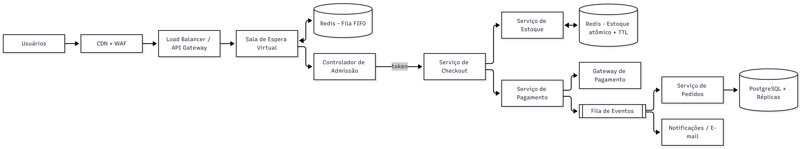

# Arquitetura: Venda de Ingressos para Show de Rock

## Decisões principais
- **Sala de espera virtual**: fila FIFO baseada no horário de chegada ao servidor, garantindo justiça independente da velocidade da internet.
- **Controlador de admissão**: libera usuários em lotes, conforme o estoque e a capacidade do checkout.
- **Reserva atômica no Redis (com TTL)**: impede vender mais ingressos do que existem.
- **Fila de eventos**: desacopla pagamento, e-mail e geração do ingresso.
- **PostgreSQL**: fonte da verdade dos pedidos.
